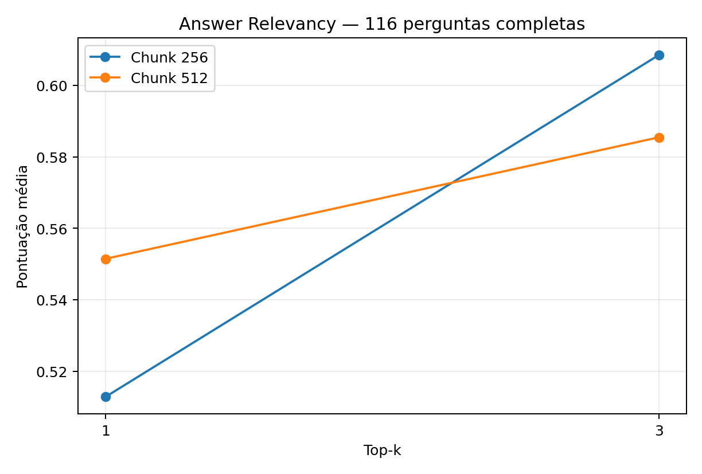
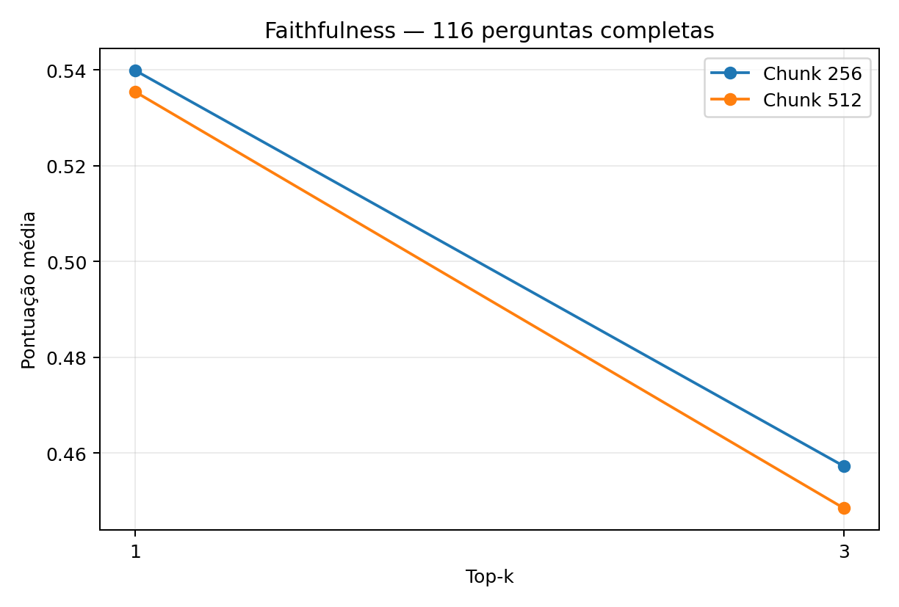
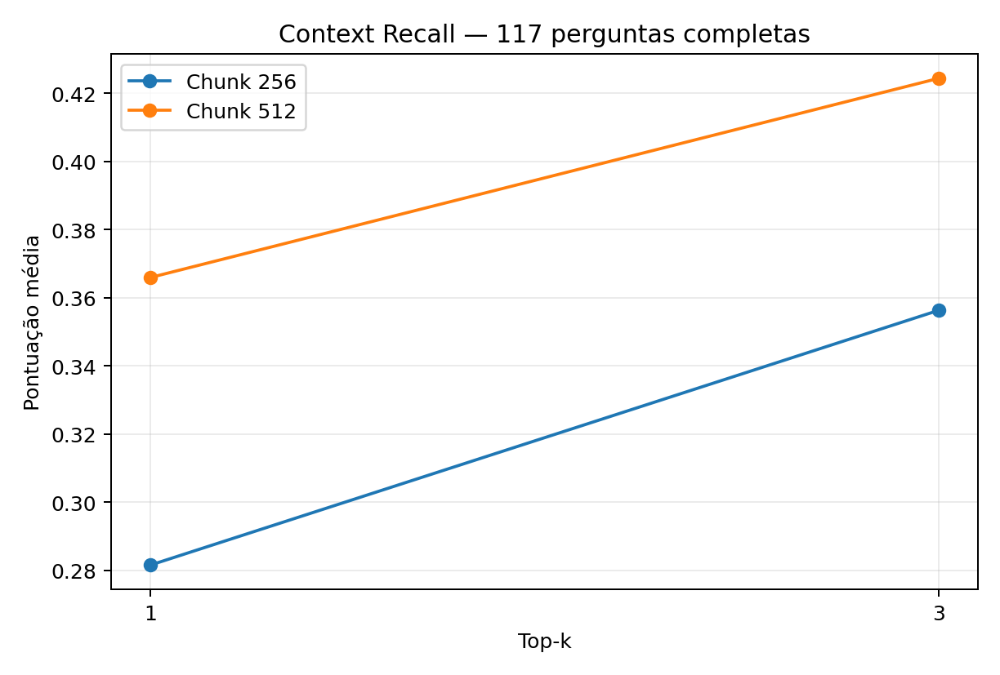
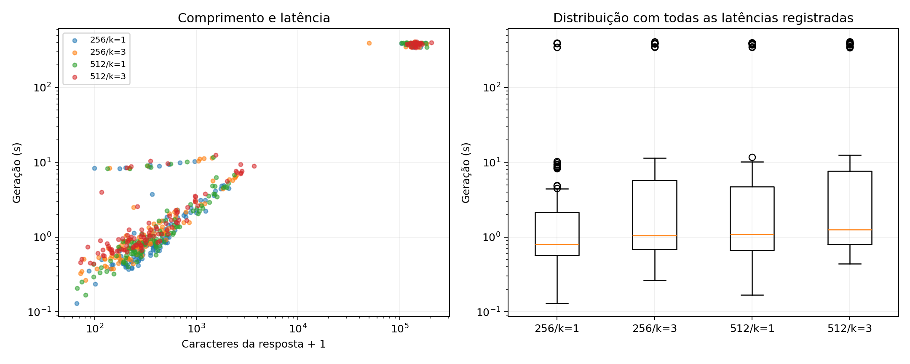
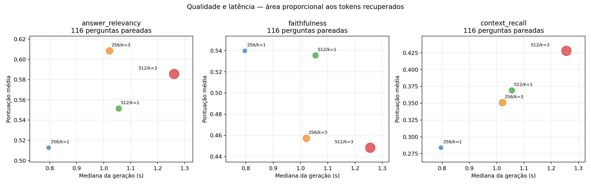

# Análise das configurações RAG no domínio tributário

Análise preparada por Guilherme. Análise de 120 perguntas em quatro configurações de recuperação, preparada em 20 de novembro de 2026 e atualizada em 21 de novembro com as condições relatadas pelo executor.

O experimento mostra um compromisso entre cobertura, fidelidade estimada e custo de geração. A configuração 256/k=3 tem as maiores médias pareadas de Answer Relevancy e das métricas lexicais; 512/k=3 tem a maior média de Context Recall; 256/k=1 usa menos contexto e tem a menor latência mediana. Apenas Context Recall apresenta diferença global após correção entre sete métricas, com Kendall W de 0,0361. A recomendação de equilíbrio é descritiva e condicionada ao objetivo de uso, sem superioridade geral demonstrada.

## Escopo e integridade dos dados

As quatro configurações são 256/k=1, 256/k=3, 512/k=1 e 512/k=3. Os chunks são medidos em tokens e o overlap configurado é 50 tokens. Cada pergunta foi avaliada uma vez por configuração; as 480 observações são medidas repetidas de 120 perguntas, não 480 perguntas independentes.

Os IDs, perguntas e gabaritos coincidem entre as quatro condições. Os contextos salvos nas previsões coincidem com os registros de recuperação. Há 480 recuperações bem-sucedidas, 479 gerações com status de sucesso e uma falha de geração em `qa_2024_0095`, na configuração 512/k=3, registrada como `prediction aborted, token repeat limit reached`. Status de sucesso técnico não garante qualidade da resposta.

O corpus efetivamente selecionado contém três normas: Instrução Normativa RFB nº 2.178, Lei nº 7.713 e Lei nº 9.250/1995. Os resultados descrevem esse recorte. O manifesto do corpus preparado mencionar 461 documentos não significa que todos participaram da busca.

O consolidado reúne quatro lotes, com 40, 40, 19 e 21 perguntas. Segundo o executor, os lotes rodaram na mesma máquina, com RTX 4050 de 6 GB, parâmetros de geração constantes, modelos carregados no início e condições similares para RAG e LLM-only. Não houve configuração específica de limite de saída nem Modelfile personalizado. O valor efetivo do limite, a versão do Ollama e os digests dos modelos não foram recuperados. A origem dessas informações e suas limitações estão em [execution_context.json](execution_context.json).

Os modelos declarados são Qwen2.5:1.5b para geração, Qwen2.5:7b para avaliação e EmbeddingGemma:300m para embeddings. A análise é retrospectiva e exploratória. O pareamento não transforma o conjunto em amostra aleatória do domínio tributário; questões relacionadas também podem reduzir a independência entre blocos.

## Método e critérios estatísticos

Cada métrica usa somente perguntas com valor finito e status `success` nas quatro configurações. Falhas e valores não aplicáveis permanecem ausentes, sem conversão para zero. A quantidade de perguntas completas varia entre 116 e 119. Context Recall pode ser avaliado mesmo quando a geração falha, pois mede contexto versus gabarito.

O Friedman compara as quatro condições usando postos dentro de cada pergunta. Além do p-valor assintótico, foram realizadas 25 mil permutações dos rótulos das condições dentro de cada pergunta, com semente 42. A correção de Holm entre as sete métricas define a comparação global adotada neste relatório. Kendall W é calculado como Q dividido por `n × 3`. A checagem por permutação complementa a aproximação do SciPy para quatro condições. [Referência do Friedman](https://docs.scipy.org/doc/scipy/reference/generated/scipy.stats.friedmanchisquare.html).

Os post-hoc usam Wilcoxon pareado bilateral, `zero_method=wilcox` e método automático do SciPy. Os contrastes fatoriais usam o mesmo procedimento sobre suas diferenças por pergunta. Para esses testes por postos, a hipótese de simetria das diferenças merece atenção; eles não são testes diretos da diferença média. O parâmetro `pratt` do notebook antigo não é o procedimento adotado nesta entrega. [Referência do Wilcoxon](https://docs.scipy.org/doc/scipy/reference/generated/scipy.stats.wilcoxon.html).

As tabelas preservam Holm dentro de cada métrica e acrescentam correções sobre todos os 42 post-hoc ou todos os 21 contrastes fatoriais. Essas famílias são distintas. A leitura conjunta conservadora usa as correções globais; resultados locais são apresentados como sensibilidade exploratória, sem alegar controle global de erro. Os intervalos bootstrap de 95%, com 5 mil reamostragens de perguntas, são pontuais e estimam efeitos médios. Por isso, não são testes equivalentes ao Wilcoxon e não devem ser usados para contornar a correção de multiplicidade.

## Comparação das quatro configurações

As médias de cada linha abaixo usam as mesmas perguntas nas quatro colunas. Coortes de métricas diferentes podem conter perguntas diferentes.

| Métrica | N completo | 256/k=1 | 256/k=3 | 512/k=1 | 512/k=3 |
|---|---:|---:|---:|---:|---:|
| Answer Relevancy | 116 | 0,5128 | 0,6085 | 0,5515 | 0,5855 |
| BLEU | 119 | 0,0360 | 0,0551 | 0,0465 | 0,0450 |
| ROUGE-1 F1 | 119 | 0,1453 | 0,1729 | 0,1440 | 0,1423 |
| ROUGE-2 F1 | 119 | 0,0593 | 0,0803 | 0,0637 | 0,0663 |
| ROUGE-L F1 | 119 | 0,1067 | 0,1264 | 0,1055 | 0,1060 |
| Faithfulness | 116 | 0,5399 | 0,4572 | 0,5354 | 0,4485 |
| Context Recall | 117 | 0,2816 | 0,3563 | 0,3660 | 0,4244 |

Aumentar o contexto coincide descritivamente com maior cobertura do gabarito, mas não com melhora consistente de fidelidade. A configuração com maior Context Recall não lidera Answer Relevancy nem as métricas lexicais. BLEU é a média da implementação por sentença com suavização existente no projeto; não é BLEU de corpus. BLEU e ROUGE medem sobreposição textual, não acerto factual.

Tabela completa: [quality_paired.csv](tables/quality_paired.csv). Contagens de sucesso, erro e ausência: [metric_status_counts.csv](tables/metric_status_counts.csv). Falhas com trechos das mensagens e hash do motivo completo: [failures.csv](tables/failures.csv).

## Efeitos principais e interação

Para cada pergunta, considerando A=256/k=1, B=256/k=3, C=512/k=1 e D=512/k=3, os contrastes são:

- Efeito de chunk: `(C + D)/2 − (A + B)/2`.
- Efeito de top-k: `(B + D)/2 − (A + C)/2`.
- Interação: `(D − C) − (B − A)`.

| Métrica | Efeito chunk | Efeito top-k | Interação |
|---|---:|---:|---:|
| Answer Relevancy | +0,0078 | +0,0648 | −0,0617 |
| BLEU | +0,0002 | +0,0088 | −0,0206 |
| ROUGE-1 F1 | −0,0159 | +0,0129 | −0,0293 |
| ROUGE-2 F1 | −0,0048 | +0,0118 | −0,0184 |
| ROUGE-L F1 | −0,0109 | +0,0101 | −0,0192 |
| Faithfulness | −0,0066 | −0,0848 | −0,0043 |
| Context Recall | +0,0762 | +0,0666 | −0,0163 |

As estimativas sugerem que top-k=3 pode favorecer pertinência e cobertura e reduzir fidelidade. O ganho de top-k em Relevancy é menor com chunk 512, expresso pela interação negativa. Entretanto, nenhum contraste fatorial permanece significativo após Holm, seja dentro da família de três contrastes de cada métrica, seja na família global de 21. As linhas não paralelas dos gráficos são evidência descritiva, sem interação estatisticamente estabelecida.

Para Context Recall, o efeito médio de chunk é +0,0762, com IC pontual de 95% [0,0146; 0,1406], e o de top-k é +0,0666, com IC [0,0101; 0,1226]. Os p-valores Wilcoxon ajustados dentro da métrica são 0,0719 e 0,0587; o IC bootstrap da média e o teste por postos tratam de hipóteses diferentes. Esses intervalos não autorizam afirmar significância após correção.

Tabela com N, intervalos e todas as correções: [factorial_effects.csv](tables/factorial_effects.csv).







## Friedman e comparações posteriores

| Métrica | N | Q de Friedman | Kendall W | p permutação com Holm entre sete métricas |
|---|---:|---:|---:|---:|
| Answer Relevancy | 116 | 1,6450 | 0,0047 | 1,0000 |
| BLEU | 119 | 1,3082 | 0,0037 | 1,0000 |
| ROUGE-1 F1 | 119 | 4,7230 | 0,0132 | 0,9302 |
| ROUGE-2 F1 | 119 | 4,0672 | 0,0114 | 0,9302 |
| ROUGE-L F1 | 119 | 7,6549 | 0,0214 | 0,3129 |
| Faithfulness | 116 | 4,8556 | 0,0140 | 0,9302 |
| Context Recall | 117 | 12,6818 | 0,0361 | 0,0353 |

Context Recall é a única métrica com rejeição global a 5%. Seu W de 0,0361 indica baixa separação global de postos. O p-valor de permutação sem correção é 0,00504, com erro Monte Carlo estimado em 0,00045; o resultado permanece aproximado. O p assintótico corrigido é 0,0376, compatível com a checagem por permutação.

No post-hoc de Context Recall, 512/k=3 supera 256/k=1 em média por 0,1428 na coorte de 117 perguntas. O p Wilcoxon é 0,00465; após Holm nos seis pares dessa métrica, 0,0279; após Holm nos 42 pares de todas as métricas, 0,1954. Assim, há evidência global de diferenças em Context Recall, mas a identificação desse par depende da família de comparações adotada. A leitura global dos 42 pares não estabelece nenhum par significativo.

Ausência de rejeição nas outras métricas não demonstra equivalência nem ausência de efeito. Não foi definida margem de equivalência ou conduzido teste de não inferioridade.

Resultados completos: [friedman.csv](tables/friedman.csv) e [posthoc.csv](tables/posthoc.csv).

## Recuperação e volume de contexto

| Configuração | Chunks por pergunta | Soma dos tokens por pergunta | Mediana da recuperação |
|---|---:|---:|---:|
| 256/k=1 | 1 | 256 | 34,68 ms |
| 256/k=3 | 3 | 768 | 25,17 ms |
| 512/k=1 | 1 | 512 | 24,12 ms |
| 512/k=3 | 3 | 1536 | 24,63 ms |

Todas as buscas retornaram o top-k solicitado. Chunks e tokens são constantes dentro de cada configuração; portanto, suas correlações com qualidade dentro da configuração são indefinidas, não iguais a zero. Os quatro níveis de contexto são melhor examinados pelos contrastes pareados do desenho fatorial. Juntar as 480 observações em uma correlação simples trataria medidas repetidas como independentes e confundiria volume com configuração.

A soma usa `metadata.token_count`, calculado com o tokenizer EmbeddingGemma. Ela inclui ocorrências sobrepostas de conteúdo e não mede informação única, tokens efetivos do prompt completo ou tokens de saída do gerador. Top-k conta chunks, que podem pertencer ao mesmo documento.

A recuperação em 256/k=1 apresenta observações de segundos em contraste com uma mediana de milissegundos. Carregamento e aquecimento são explicações possíveis, mas não estão isolados nos registros. Sua média maior não demonstra que recuperar um chunk pequeno seja intrinsecamente mais caro.

Dados completos: [retrieval_summary.csv](tables/retrieval_summary.csv).

## Latência e respostas repetitivas

Os valores abaixo incluem todas as gerações com duração registrada, sem retirar respostas longas. A única geração abortada não tem duração disponível e fica fora dos tempos; portanto, a soma é tempo de gerações registradas, não tempo total de execução do experimento.

| Configuração | N com tempo | Mediana | Média | P95 | Respostas acima de 10 mil caracteres | Parcela do tempo nessas respostas |
|---|---:|---:|---:|---:|---:|---:|
| 256/k=1 | 120 | 0,80 s | 23,80 s | 348,21 s | 7 | 92,95% |
| 256/k=3 | 120 | 1,05 s | 59,00 s | 392,61 s | 18 | 97,21% |
| 512/k=1 | 120 | 1,09 s | 59,36 s | 392,44 s | 18 | 97,15% |
| 512/k=3 | 119 | 1,26 s | 71,98 s | 393,53 s | 22 | 97,50% |

As 65 respostas acima de 10 mil caracteres concentram 96,82% dos 25.624,45 segundos de geração registrados nas quatro condições. A maior possui 206.126 caracteres. A mesma contagem de respostas longas e a mesma parcela de tempo aparecem usando cortes de 5 mil e 20 mil caracteres. Trata-se de uma análise de sensibilidade do diagnóstico, não de um critério para excluir casos ou recalcular uma suposta qualidade corrigida.

O indicador de repetição é `1 − número de 4-gramas distintos / número total de 4-gramas`, sobre as últimas 2 mil palavras separadas por espaços. Entre as respostas longas, 5 de 7, 16 de 18, 17 de 18 e 20 de 22, respectivamente, ultrapassam 80% nesse indicador. Esse cálculo e os trechos finais mostram repetição frequente; não constituem diagnóstico automático de validade factual.

Comprimento da resposta e latência têm associação de Spearman positiva em todas as configurações, com rho entre 0,795 e 0,899. Os p-valores aproximados permanecem baixos após Holm nas quatro configurações. A associação é compatível com maior custo para produzir textos extensos. O executor relatou carregamento inicial e condições similares, mas os registros não separam quantidade de tokens, taxa de geração ou eventual tempo de carga. A ausência de configuração específica de limite de saída não demonstra que a geração estava ilimitada nem estabelece a causa das repetições.



Arquivos: [latency_diagnostics.csv](tables/latency_diagnostics.csv), [latency_threshold_sensitivity.csv](tables/latency_threshold_sensitivity.csv), [repetition_summary.csv](tables/repetition_summary.csv) e [response_diagnostics.csv](tables/response_diagnostics.csv).

## Associação entre recuperação e qualidade

As correlações de Spearman foram calculadas separadamente por configuração entre caracteres recuperados ou latência de recuperação e quatro métricas de qualidade. Das 64 combinações previstas, 32 são indefinidas porque quantidade de chunks e tokens não varia. Nenhuma das 32 correlações calculáveis permanece significativa após Holm nessa família.

A maior associação em magnitude é entre caracteres recuperados e ROUGE-L em 512/k=3: rho de −0,2596, p aproximado de 0,00436 e p ajustado de 0,1395. Os dados não estabelecem uma associação consistente entre essas variáveis e qualidade. Também não demonstram ausência de relação; os testes são exploratórios e não causais.

Os p-valores de Spearman são aproximações. Perguntas relacionadas, múltiplos lotes e tamanho amostral limitam interpretações inferenciais. A entrega evita a correlação agrupada entre condições. Resultados: [retrieval_correlations.csv](tables/retrieval_correlations.csv).

## Equilíbrio entre qualidade e custo

O custo observado é descrito por latência e volume de contexto. Não há medidas de energia, utilização de GPU, pico de VRAM ou contadores completos de tokens de geração. Nenhuma razão arbitrária entre nota e segundos é usada para criar um ranking único.

O gráfico usa uma coorte pareada por métrica, exigindo qualidade válida e duração de geração disponível nas quatro condições. Em cada painel há 116 perguntas; em Context Recall, isso exclui da visualização um caso que permanece no Friedman de 117 perguntas. As áreas dos pontos representam tokens recuperados.



Para priorizar pertinência e aproximação textual ao gabarito, 256/k=3 é uma candidata de compromisso: lidera as médias dessas métricas e usa metade do contexto de 512/k=3. A mediana de geração no conjunto completo de tempos é cerca de 31% maior que a de 256/k=1, e a frequência de respostas longas é maior. Sua média de Faithfulness também é menor. Essa escolha é operacional e descritiva; não há superioridade geral estatisticamente demonstrada.

Para priorizar economia de contexto, latência típica e a maior média observada de fidelidade, 256/k=1 é uma opção conservadora de configuração. Para priorizar cobertura do gabarito, 512/k=3 apresenta a maior média, com seis vezes os tokens de 256/k=1 e maior frequência de gerações extensas. Nenhuma dessas escolhas garante correção jurídica.

A recomendação para o grupo é apresentar 256/k=3 como compromisso condicionado a pertinência e sobreposição textual, acompanhada de 256/k=1 como alternativa de menor custo e 512/k=3 como alternativa de cobertura. Antes de uso operacional, é necessário controlar e verificar as gerações repetitivas, registrando o limite de saída em uma nova rodada se esse comportamento for objeto de correção.

## Material de entrega e reprodução

- [Condições de execução](execution_context.json): hardware, modelos, condições relatadas pelo executor e parâmetros ainda não estabelecidos.
- [Proveniência](provenance.json): hashes dos dados de entrada, versões das bibliotecas e arquivos exportados.
- `tables/`: efeitos, testes, coortes, correlações e diagnósticos por caso.
- `figures/`: gráficos científicos em PNG.

Na raiz de `ia025/`, em ambiente com as dependências analíticas do projeto:

```bash
python -m app.evaluation.analyze_end_to_end \
  --experiment-dir files_ia_025/consolidated_120_cases_20261108T165307Z \
  --output-dir evaluation_results/rag_configuration_analysis/reproduced \
  --bootstrap-iterations 5000 --seed 42

python scripts/analysis/audit_rag_configurations.py
python scripts/analysis/prepare_rag_analysis_delivery.py
```

Os comandos não chamam Ollama ou geram novas respostas. Os dois scripts adicionais aceitam caminhos por argumentos `--help`. Os dados brutos continuam necessários para reprodução e permanecem fora deste pacote de documentação. Os textos interpretativos são vinculados a este consolidado; usar outros dados exige revisar as conclusões e as tabelas no corpo do relatório. As análises geradas anteriormente em `evaluation_results/` ficam como material de trabalho, enquanto esta pasta em `docs/` pode ser versionada.
